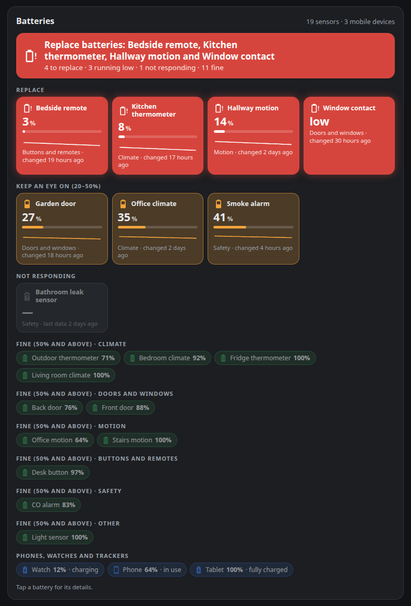
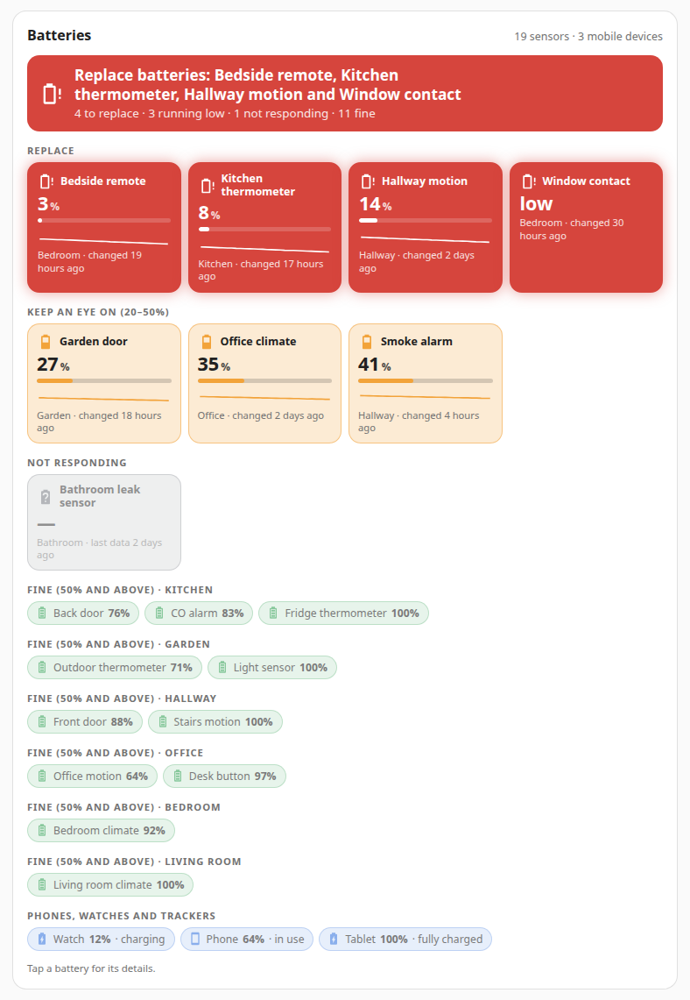
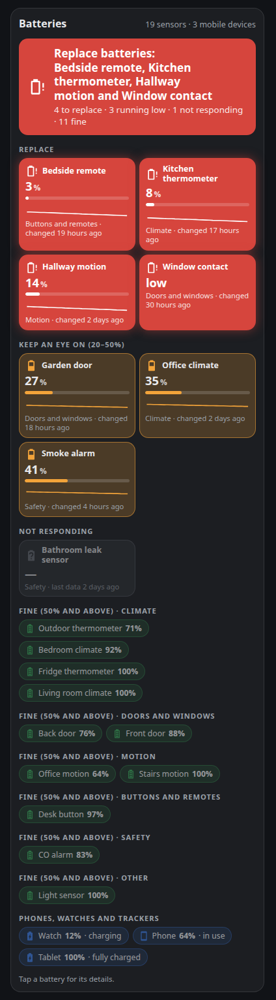

# Battery Check Card

A Home Assistant dashboard card that finds every battery in your home by itself and answers one question at a glance:
**which batteries do I replace now?**



- A banner on top: *Replace batteries: Bedside remote, Kitchen thermometer…*, red when something needs doing, calm
  when everything is fine.
- **Replace** (below 20%) in full red, **keep an eye on** (20–50%) in amber, **not responding** dimmed grey, each with the
  level, a bar, the 30-day trend and when it last changed.
- Batteries that are fine shrink to small green chips, grouped by what the device does (or by area).
- Phones, watches and trackers apart, with their charging state.
- No configuration needed. No animations, works at phone width, follows your light or dark theme.

| Grouped by area, light theme | On a phone |
|---|---|
|  |  |

## Requirements

- Home Assistant 2024.8 or newer.
- Battery entities with `device_class: battery`, which is what almost every integration (Zigbee2MQTT, ZHA, Matter,
  Bluetooth, the Companion app…) already provides.

## Installation

### Marketplace (Home Assistant 2026.11 and newer)

Until the card is in the default catalogue, add it by link: open **Settings → Marketplace**, choose
**Add from link**, paste `https://github.com/AldebaranPrimo/battery-check-card`, then install **Battery Check Card**.
Reload the page in the browser afterwards.

### HACS (before 2026.11)

HACS → three dots → **Custom repositories** → add `https://github.com/AldebaranPrimo/battery-check-card` with type
**Dashboard**, then download **Battery Check Card**.

### Manual

Copy `battery-check-card.js` to `/config/www/`, then add a dashboard resource (Settings → Dashboards → three dots →
Resources) with URL `/local/battery-check-card.js` and type **JavaScript module**.

## Configuration

```yaml
type: custom:battery-check-card
```

That is all most homes need. A fuller example:

```yaml
type: custom:battery-check-card
title: Sensor batteries
critical: 15
low: 40
group_by: area
exclude:
  - sensor.old_remote_battery
  - sensor.test_*            # * matches anything
mobile:
  - sensor.e_bike_battery    # show it with the phones and trackers
names:
  sensor.th_a4c1_battery: Kitchen thermometer
```

| Option | Default | Description |
|---|---|---|
| `title` | *Batteries*, translated | Card title. |
| `critical` | `20` | Below this percentage a battery is in **Replace**. |
| `low` | `50` | Below this percentage (and from `critical` up) a battery is in **Keep an eye on**. |
| `group_by` | `category` | How fine batteries are grouped: `category`, `area` or `none`. |
| `exclude` | none | Entity ids to leave out; `*` is a wildcard. |
| `include` | none | Extra percentage sensors to treat as batteries even without `device_class: battery`. |
| `mobile` | none | Entity ids to show with phones, watches and trackers. |
| `names` | none | Map of entity id to the name shown on the card. |
| `show_ok` | `true` | Show the chips of the batteries that are fine. |
| `show_mobile` | `true` | Show phones, watches and trackers. |
| `show_storage` | `false` | Show big batteries such as home or vehicle storage (see below). |
| `trend` | `true` | 30-day trend line on the batteries that need attention. |
| `language` | Home Assistant language | `en` or `it`; other languages fall back to English. |

## How the card decides

- **Batteries**: every `sensor` with `device_class: battery` (a percentage) and every `binary_sensor` with
  `device_class: battery` (on = low). A low-battery binary sensor gets a tile of its own only when its device has no
  percentage sensor. When the device has both and the binary sensor says the battery is low, the percentage tile goes in
  **Replace** whatever its value.
- **Not responding**: the state is `unavailable` or `unknown`; the tile shows when the last data arrived.
- **Names**: the friendly name without a trailing "Battery", "Battery level" or "Battery low"; the device name if
  nothing is left. Use `names:` to change one.
- **Categories** come from the other entities of the same device, in this order: *Safety* (smoke, carbon monoxide, gas,
  moisture, safety, problem), *Doors and windows* (door, window, opening, garage door, lock), *Motion* (motion,
  occupancy, presence, vibration), *Climate* (temperature, humidity, pressure, CO₂, particles, VOC), *Buttons and
  remotes* (button and event entities), otherwise *Other*. With `group_by: area` the entity's area is used, or its
  device's.
- **Phones, watches and trackers**: a battery whose device also has a `device_tracker`, or with a `…_battery_state`
  sensor next to its `…_battery_level` (the Companion app does this); the charging state comes from that sensor. This is
  a heuristic: use `mobile:` and `exclude:` to correct it.
- **Storage**: a battery whose device also measures current and voltage or power (home batteries, power stations,
  vehicles) is hidden unless `show_storage: true`, because its level is not about replacing anything.
- **Trend**: daily means of the last 30 days from Home Assistant's long-term statistics. A sensor without
  `state_class: measurement` has no statistics and simply shows no line.

Tap a battery to open its details.

## Translations

Texts live in the `STRINGS` object at the top of `battery-check-card.js`. Pull requests with new languages are welcome.

## Licence

[MIT](LICENSE)
